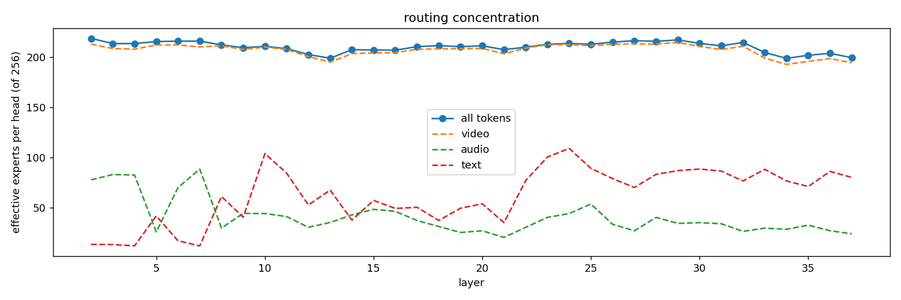
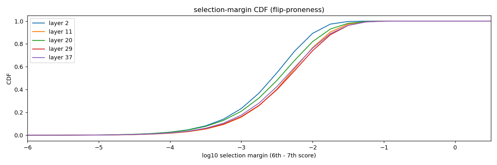
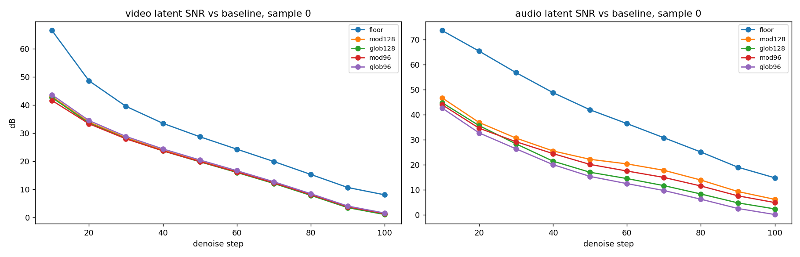
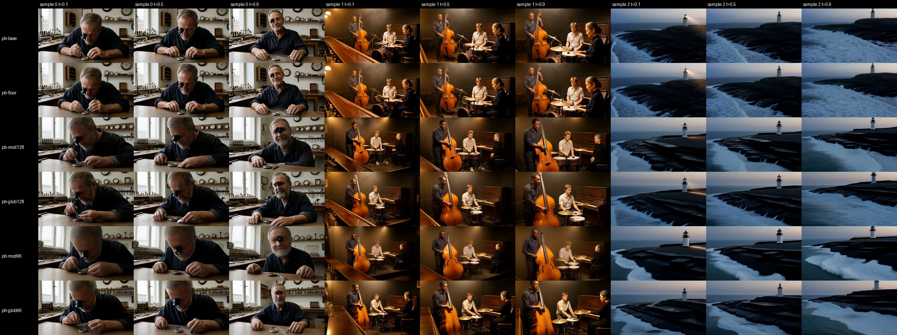
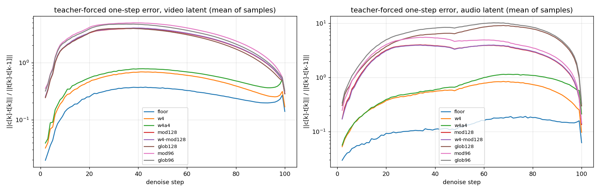
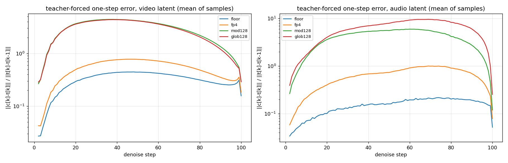

[MAGI-2 Preview](https://github.com/SandAI-org/MAGI-2-preview) is Sand AI's open
audio-video generator: a 114B-parameter diffusion transformer with 6B active, producing
ten-second clips with stereo sound in two stages (a 540p preview model, then a 1080p
refiner). It was released for H100-class machines. This note is what it took to run it on
a B300, and what I learned about the model once it was running.

The work falls into three parts. The first is engineering: three kernels that only exist
as sm_90a binaries had to be replaced. The second is measurement: once the model ran, I
instrumented its mixture-of-experts router to see whether the 217 GB of expert weights
could be cut down, which led to a scoring method the usual metrics could not provide. The
third is the result of that measurement: pruning is the wrong tool for this model, 4-bit
experts are the right one, and with them the preview model fits on one GPU.

## The Blackwell port

The released code assumes Hopper in three places. FlashAttention-3 handles the preview
model's attention with its attention sinks; MagiAttention's flexible flash attention
kernel handles the refiner's windowed attention over a list of token ranges; and a fused
Triton kernel runs the multi-head mixture of experts. All three are compiled for sm_90a
and refuse to load on sm_103. Triton 3.5, the version in the NGC PyTorch 25.10 image,
also fails to lower the MoE kernel for sm_103 at all, and torch's FlexAttention dies in
the same place (`tcgen05.wait.st` has no selection pattern).

| Component | Hopper path | Blackwell path |
|---|---|---|
| Preview attention with sinks | FlashAttention-3 | MagiAttention's FA4 backend (CuTe DSL), with the FA3 sink correction; FlashAttention-2 as the fallback |
| Multi-head MoE, 36 layers, 12 heads x 256 experts | fused Triton kernel | `torch._grouped_mm` with a Triton routing kernel, a flat gather, a Triton SwiGLU, and an inverse-permutation combine |
| Refiner windowed attention | MagiAttention FFA kernel | FlashAttention-2 varlen over the gathered key-value ranges of each query segment |
| Refiner attention through FA4 | not applicable | works, but materialises a dense (ranges x sequence) table: 1.5 TB at 1080p, so it is opt-in |

The FA4 backend was the easy win: 3.3x faster than FlashAttention-2 at the 40k to 100k
token lengths of the preview model, with bit-identical log-sum-exp. The refiner was the
hard one. MagiAttention's FA4 path lowers the range list into a function table with one
row per range, and the 1080p refiner has about 391,000 range pairs over 515,000 tokens.
Gathering each query segment's key-value ranges into one varlen FlashAttention-2 call is
exact (the softmax is over the concatenated ranges, so there is no log-sum-exp merge) and
runs at 117 ms per layer call.

The MoE path went through two rounds. The first replaced the Triton kernel with
`torch._grouped_mm` and a compiled SwiGLU, which took the layer call from 52 ms to 13 ms.
A per-step profile then showed that at the two-GPU shape only 10 ms of a 55 ms layer call
was in the three grouped GEMMs; the rest was glue (a 9 ms `torch.topk` over 256 experts,
a 10 ms fancy-index gather, a SwiGLU compiled with dynamic shapes at 2.6x the static cost,
chunk copies, and a bf16 `scatter_add`). Replacing each piece brought the call to 18 ms
and the preview step from 3.75 s to 2.78 s of CUDA time on two GPUs. cuBLAS refuses
grouped GEMMs with 1024 or more groups, and expert parallelism over two GPUs puts 1536
experts on a rank, so the call is sliced at 768 groups.

Two numbers describe the result. A 1080p clip takes about 12.5 minutes on four GPUs
(5.2 minutes of preview denoise, 2.3 of refiner, the rest prompt enhancement, text
encoding, VAE decode and one-time compilation), and a 540p preview clip takes about seven
minutes on two. Same-seed clips before and after each kernel change land at 24 to 27 dB
PSNR against each other: same composition, small pose drift. That number comes back later
as the floor every other measurement sits on.

The preview model's prompt enhancer calls an LLM through an OpenAI-style endpoint. Pointed
at a local reasoning model, the thinking phase could consume the whole token budget and
return an empty or truncated caption, which killed a batch at its fifth clip. The client
now disables thinking by default, retries on bad JSON, and caches captions across runs.
The cache matters more than it sounds: prompt enhancement is sampled, so without it two
runs of the same prompt and seed are not comparing the same clip. That bit me once before
the measurements below.

## Where the router sends its tokens

Every one of the 36 MoE layers has 12 heads, each choosing 6 of 256 experts per token with
a sigmoid score plus the checkpoint's auxiliary-loss-free bias. That is 110,592 (head,
expert) pairs of 1.97 MB each. The obvious question for a 217 GB model is whether all of
them are used. I logged every routing decision over 18 clips (nine prompts covering
dialogue, music, ambience and image-to-video, each in landscape and portrait), 100 denoise
steps each, keeping per-token labels through the context-parallel scatter, the per-shard
modality permute and the expert-parallel all-to-all. That is 7.7 billion decisions per
layer. The findings:

1. **There are no dead experts.** 14 of the 110,592 pairs were never selected over the
   corpus. Each single clip leaves 130 to 350 pairs unused, but the union over clips is
   902 and the intersection collapses as clips are added. "Dead on my prompts" does not
   generalise.
2. **Utilisation is flat.** About 210 of 256 experts per head are effectively in use.
   The top 128 experts per head cover 73 percent of selections, the top 192 cover 93
   percent. There is no long tail to remove for free.
3. **Audio and text use small, separate cores.** Audio tokens route to about 41 effective
   experts per head, text to about 62, and their high-mass sets overlap video's at a
   Jaccard index of 0.16 and 0.24. Video touches almost everything, including audio's
   experts. A ranking by global utilisation keeps only 60 percent of audio's selections
   at 128 experts per head; a modality-aware ranking keeps 99 percent.
4. **Routing re-weights across the denoise but does not change sets.** The cosine between
   the utilisation vectors of the first and last ten steps is 0.45 on average, yet almost
   no pair is exclusive to high or low noise.
5. **Conditional and unconditional passes route the same** (cosine 0.986), so there is
   no smaller sub-model to be had for the null-text half of classifier-free guidance.
6. **Selection is flip-prone.** 78 percent of top-6 picks have a gap below 0.01 between
   the sixth and seventh score, and 18 percent below 0.001. This is the mechanism behind
   the 24 to 27 dB same-seed PSNR across kernel changes: any rounding difference flips
   some routing decisions, and the denoise amplifies the flip.
7. **Experts own image regions.** The figure at the top of this note is head 0 of layer
   20 at step 50 of a clip: one expert covers the person's silhouette, others the
   background, strong edges, and a highlight. Routing is semantic, which is also why it is
   prompt-dependent.

<figure class="two">
  
  
  <figcaption>Left: effective experts per head stay near 210 of 256 across layers. Right: the gap between the last selected expert and the first rejected one is below 0.01 for 78 percent of picks, so selection flips under any rounding change.</figcaption>
</figure>

Landscape and portrait corpora agree on every number to the second digit, so none of this
depends on the token grid.

## Pruning by masking the router

The dissection says any prune removes experts that are in use, so the question is a
quality curve. The cheapest way to draw it is to mask the router: add a large negative
bias to every (head, expert) pair outside the kept set, so it never enters a top-6 and the
survivors renormalise. That is exactly what deleting the expert does, without touching
weights or memory. I built four masks from the corpus, uniform per head: 128 or 96 experts
kept, ranked either by global utilisation or by the maximum over modalities of the expert's
share of that modality's selections.

Scored end to end against the unpruned run on three held-out prompts (a watchmaker's line
of dialogue, a jazz trio, a coastal drone shot with a foghorn), the masks all landed in the
same place: about 15 dB frame PSNR and 3.4 dB video-latent SNR at the end of the denoise.
The useful comparison is the control: a second unpruned run differing only in the
precision of the MoE combine (bf16 instead of fp32 accumulation) ends at 22.9 dB PSNR and
9.9 dB latent SNR. Kernel rounding alone decays the latent SNR from 66 dB at step 10 to
8 dB at step 100, about 6 dB per ten steps.

<figure>
  
  <figcaption>Latent SNR against the unpruned run across the denoise. The control run, which differs only in the precision of one kernel, decays at the same slope as every pruned run. Reference-based metrics measure the chaotic amplification, not the prune.</figcaption>
</figure>

Two things follow. Reference-based metrics cannot grade pruning of this model: the floor
swallows them, because a perturbation of any size gets amplified at the same exponential
rate through the sampler. And 15 dB PSNR does not mean a broken clip. The contact sheet
below shows every pruned run rendering its prompt coherently, with composition and
lighting moving the way they move between seeds. With half or even three-eighths of its
experts, the model samples a different point of the same distribution.

<figure>
  
  <figcaption>Frames at 10, 50 and 90 percent of the clip for the unpruned run, the precision control, and the four masks. Every row is a plausible clip of the prompt; no row is the same clip as another.</figcaption>
</figure>

Audio is where the ranking rule shows: the global masks lose 7 to 10 dB of audio-latent
SNR against the modality-aware masks at the same size, in the order the coverage numbers
predicted.

## Teacher-forced one-step scoring

To separate a perturbation from its amplification, hold the input fixed. Before every
denoise step, the sampler replaces its latents with the teacher run's latents after the
previous step, so the candidate model sees exactly the input the dense model saw, and the
difference after the step is this step's prediction error alone. The metric is that error
relative to the size of the dense model's own update, plus the SNR of the post-step
latent:

error[k] = ‖c[k] − t[k]‖ / ‖t[k] − t[k−1]‖, where t is the teacher trajectory and c the candidate's one step from t[k−1]

The teacher is one baseline run with latents dumped at every step; each candidate then
costs about 19 minutes on two GPUs for three prompts. Averaged over 99 steps and the three
held-out prompts:

| Run | Video error / update | Audio error / update | Video SNR | Audio SNR |
|---|---|---|---|---|
| bf16 combine (the kernel floor) | 0.27 | 0.13 | 53.2 dB | 59.8 dB |
| 128 experts, modality-aware | 2.60 | 2.89 | 33.5 dB | 33.7 dB |
| 128 experts, global | 2.53 | 5.63 | 34.0 dB | 28.4 dB |
| 96 experts, modality-aware | 3.26 | 3.72 | 31.6 dB | 31.6 dB |
| 96 experts, global | 3.02 | 6.64 | 32.3 dB | 26.8 dB |

Under teacher forcing the floor's error is flat across the denoise (0.14 at step 10, 0.14
at step 100, peaking at 0.40 around step 40), where in the end-to-end measurement the same
kernel difference had decayed the latent SNR by 58 dB. The amplification is gone and what
is left is the perturbation. The per-sample spread is 2 to 4 dB, so three prompts rank the
candidates; a second set of ten prompts, scored below, confirms the ranking.

The ranking is clear. The kernel floor moves the velocity by 27 percent of a step (a
number that includes the routing flips the rounding causes). Removing half the experts
moves it by 2.5 to 2.6 steps, ten times the floor, and removing five-eighths by 3.0 to
3.3. The error peaks in steps 20 to 60, where structure and motion are decided, and
collapses at the last step, where the update is tiny. The pruned model's velocity is not
a slightly noisy dense velocity: at mid-denoise it points somewhere else, and the clips
stay coherent only because the flow re-estimates from the current latent at every step.
The modality-aware rule costs 0.4 dB of video against the global rule and buys 5 dB of
audio, so it stays the rule. Going from 128 to 96 experts costs 2 dB, consistent with a
flat utilisation: the price is paid for leaving the flat part at all, not per expert.

## NVFP4 experts on the same metric

NVFP4 stores each weight as a 4-bit E2M1 value with an 8-bit E4M3 scale per block of 16
along the reduction dimension and one fp32 scale per matrix: 4.5 bits per weight, 9.5
percent RMS error on Gaussian weights. The expert matrices are 256 by 1280 and 1280 by 256,
so the block scales run along the 256 or 1280 axis of each GEMM. I first fake-quantised
the experts at load (quantise, dequantise, keep bf16 storage and math) to get the number
without writing a kernel, with and without also quantising the two GEMM input activations
with a dynamic per-tensor scale.

| Run | Video error / update | Audio error / update | Video SNR | Audio SNR |
|---|---|---|---|---|
| bf16 combine (the kernel floor) | 0.27 | 0.13 | 53.2 dB | 59.8 dB |
| NVFP4 weights | 0.46 | 0.53 | 48.4 dB | 48.2 dB |
| NVFP4 weights and activations | 0.55 | 0.69 | 46.7 dB | 46.2 dB |
| 128 experts, modality-aware | 2.60 | 2.89 | 33.5 dB | 33.7 dB |
| 128 experts, modality-aware, plus NVFP4 weights | 2.64 | 2.88 | 33.4 dB | 33.7 dB |

<figure>
  
  <figcaption>One-step error by step, mean over the three prompts, log scale. Quantisation (orange, green) has the floor's shape, only larger. Pruning (the upper band) is a different kind of perturbation.</figcaption>
</figure>

Four-bit weights cost 5 dB where pruning half the experts cost 20. Weight-only
quantisation is 1.7 times the floor, weights and activations 2.1 times, and the per-step
shape matches the floor's: quantisation behaves like kernel noise. The errors of pruning
and quantisation add in quadrature (2.64 = sqrt(2.60² + 0.46²)), so they are independent,
and on a pruned model the quantisation would be invisible. Audio tolerates FP4 less well
than video (a 12 dB drop against video's 5), because its 250 tokens route to about 41
experts per head and each expert's error is less averaged; it still sits 15 dB above
every prune.

A second set of ten held-out prompts (a painter's line of dialogue, two boys cycling
through sunflower fields, a cellist, a street-food wok, bread-making, reindeer on a frozen
river, a punk band, a bumblebee in a greenhouse, a rooftop conversation, a ballet dancer
backstage) was run through the same protocol, with the floor, the packed FP4 path and the
two 128-expert masks:

| Run, ten prompts | Video error / update | Audio error / update | Video SNR | Audio SNR |
|---|---|---|---|---|
| bf16 combine (the kernel floor) | 0.32 | 0.15 | 51.3 dB | 58.2 dB |
| NVFP4 weights, packed | 0.53 | 0.64 | 47.1 dB | 46.5 dB |
| 128 experts, modality-aware | 2.93 | 4.02 | 32.5 dB | 30.9 dB |
| 128 experts, global | 2.85 | 6.14 | 32.8 dB | 27.3 dB |

<figure>
  
  <figcaption>The same measurement on the ten-prompt set. The bands are where they were on three prompts.</figcaption>
</figure>

Every number is 10 to 20 percent higher than on the first three prompts (the new set has
crowds, macro detail and fast camera moves) and every ratio holds: FP4 at 1.6 times the
floor, the masks at 9 times, the global rule still 3.6 dB worse on audio for 0.3 dB better
on video.

That settled the memory question: FP4 experts halve the same bytes as a 50 percent prune
at under a fifth of the one-step error, without choosing losers in a flat distribution.
Pruning is retired as a memory tool for this model.

## The preview model on one GPU

The real path packs each MoE layer's three expert parameters into NVFP4 buffers in the
tensor-core layout after the checkpoint loads and before the model moves to the GPU, and a
Triton kernel dequantises each chunk of up to 768 experts to bf16 in front of the existing
grouped GEMM. Numerics are bit-identical to the fake-quant path (0 mismatches over 2.6
million values in the unit test), which made the fake-quant scores the regression test for
the kernel.

| Run | Video error / update | Audio error / update | Video SNR | Audio SNR | GPUs | s per step | Wall, 3 clips |
|---|---|---|---|---|---|---|---|
| bf16 experts | 0.27 | 0.13 | 53.2 dB | 59.8 dB | 2 | 2.9 | 19:17 |
| NVFP4, fake quant | 0.463 | 0.532 | 48.4 dB | 48.2 dB | 2 | 2.9 | 19:49 |
| NVFP4, packed | 0.463 | 0.532 | 48.4 dB | 48.2 dB | 2 | 2.9 | 19:53 |
| NVFP4, packed, one GPU | 0.464 | 0.525 | 48.4 dB | 48.3 dB | 1 | 5.5 | 32:23 |

The experts pack to 57 GB from 217 GB. With the text encoder, the refiner and the VAE all
resident, the single-GPU run peaks at 124 GB allocated and 168 GB on the device, of the
B300's 275 GB. The step time is 5.5 s at 540p against 2.9 s on two GPUs: one GPU does the
work of two at 1.9 times the step time, which is the same throughput per GPU with half the
hardware tied up per clip. Dequantisation costs about 0.1 s per step. The expert-parallel
layout does not change the numbers, which is the last check the packed path needed.

The full 1080p pipeline fits too. With the refiner and the VAE running on the same GPU
after the FP4 preview, a 1080p clip completes on one B300 with 145 GB allocated and a peak
of 255 GB reserved during the refiner's windowed attention, in about 20 minutes for the
first clip of a run (model load and compilation included).

### The FP4 tensor-core GEMM, built and benchmarked, not used

The compute half of NVFP4 is a block-scaled grouped GEMM on the FP4 tensor cores. None of
the prebuilt ones run on this chip: sgl-kernel 0.3.21 and the vLLM wheels carry sm_100a
and sm_120a cubins only, and the B300 is sm_103, so `cutlass_fp4_group_mm` fails in
initialisation. torch 2.9's `_scaled_grouped_mm` has no NVFP4 recipe, and the CuTe DSL
tree has no block-scaled grouped example. So I built vLLM v0.11.0's FP4 kernels (the
CUTLASS SM100 block-scaled grouped GEMM and its two quantisers) from source for sm_103a as
a torch library, with three small patches for CUDA 13. It is correct: 1.0 percent from the
fake-quant reference, which is the kernel's own rounding, and 13.4 percent from bf16,
which is sqrt(2) times 9.5 percent, exactly the weights-and-activations number.

At MAGI-2's shapes it does not pay. With 768 experts of 2600 rows each:

| GEMM | bf16 grouped GEMM | NVFP4 GEMM | NVFP4 with activation quantisation |
|---|---|---|---|
| gate and up, K=256, N=1280 | 1.97 ms (665 TFLOP/s) | 2.36 ms (554) | 5.02 ms (261) |
| down, K=1280, N=256 | 1.12 ms (1165) | 0.84 ms (1563) | 4.69 ms (279) |

The experts are 256 wide. With a reduction dimension of 256 the FP4 GEMM is slower than
bf16 (the block-scale plumbing dominates), only the down projection gains 1.3x, and the
activation quantiser costs 2 to 4 times the GEMM itself. The expert GEMMs are about 0.4 s
of a 2.9 s step, so even a free FP4 GEMM would buy under 10 percent. The FP4 path
therefore stays weight-only: packed storage, bf16 math. The kernel and its test are kept
for a model whose experts are wide enough to use it.

## What is next

- The single-GPU 1080p run above used the default refiner settings; the refiner's 255 GB
  reserved peak leaves little headroom, and a smaller key-value gather budget would trade
  time for memory if a 1080p run ever needs it.
- The teacher-forced score ranks any future knob at 19 minutes per candidate: a lower
  top-k, expert merging, or a static activation scale. Whether a 128-expert physical
  prune is ever worth its 108 GB on top of FP4 is a question for a no-reference quality
  battery, not for this metric.

## Reproduce

The port, the FP4 path and the prompt-enhancement fixes are the three pull requests
linked at the top of this note; the branches they come from carry the same code with the
lab's instrumentation stripped. The instrumentation (routing statistics, trajectory dumps,
teacher forcing, router masks) lives on a lab branch and is available on request. The
analysis and scoring scripts are in
[`code/magi2`](https://github.com/3whiskeywhiskey/research/tree/main/code/magi2) of this
site's repository:

- `magi2-route-analysis.py` turns per-layer routing statistics into the figures and
  numbers of the dissection section.
- `magi2-build-expert-mask.py` builds a keep-mask from those statistics with either
  ranking rule.
- `magi2-prune-score.py` is the end-to-end comparison (latent SNR, frame PSNR and SSIM,
  log-mel distance, the contact sheet).
- `magi2-teacher-score.py` is the teacher-forced one-step score.

All runs: seed 46, 100 preview steps, prompt enhancement with cached captions, 896 by 512
preview resolution, NGC PyTorch 25.10 with CUDA 13, torch 2.9 and Triton 3.5.

## Changelog

- 2026-11-03: first version. Three held-out prompts; ten-prompt batch running.
- 2026-11-03: added the single-GPU 1080p result (full pipeline, 255 GB peak reserved).
- 2026-11-03: added the ten-prompt teacher-forced set; headline ratios revised from 1.7x and 10x to 1.6x and 9x.
